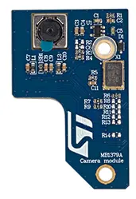

.. _st_mb1379_cam:

ST MB1379 Camera module (OV5640)
################################

Overview
********

The camera module MB1379 features a Omnivision OV5640 sensor accessible
via a 40 connector. This module is also mounted on the B-CAMS-OMV-MB1683
shield which allows for connecting this module on STM32 boards with a ZIF
connector.

Usage
*****

The shield can be used in any application by setting ``SHIELD`` to
``st_mb1379_cam`` and adding the necessary device tree properties.

Set ``--shield st_mb1379_cam`` when you invoke ``west build``. For example:

.. zephyr-app-commands::
   :zephyr-app: samples/subsys/video/capture
   :board: stm32f769i_eval
   :shield: st_mb1379_cam
   :goals: build
